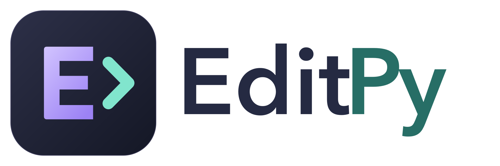
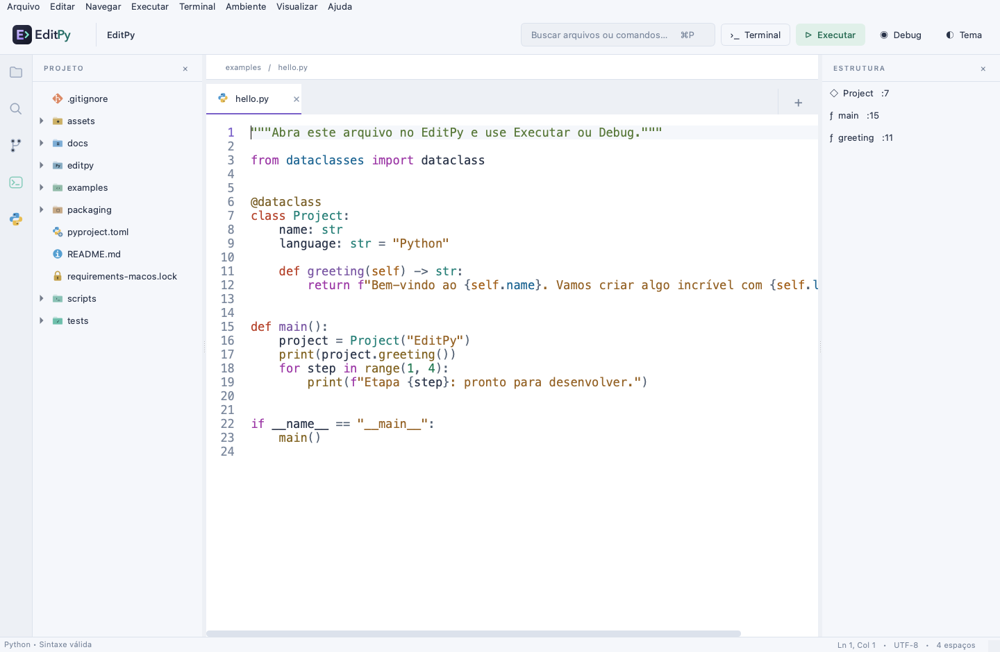

# EditPy

<picture>
  <source media="(prefers-color-scheme: dark)" srcset="assets/brand/editpy-logo-dark.png">
  
</picture>

IDE Python independente, com desenvolvimento iniciado no macOS Intel e arquitetura em Python/Qt para futura distribuição em Windows e Linux.

**Versão 0.3.0: ícones por formato e realce sintático ampliado. Ainda não oferece equivalência completa ao PyCharm.** O detalhamento do produto e os recursos pendentes estão em [docs/ROADMAP.md](docs/ROADMAP.md).

<picture>
  <source media="(prefers-color-scheme: dark)" srcset="docs/screenshots/dark.png">
  
</picture>

## Abrir no macOS

Depois de gerar o pacote, abra `dist/EditPy.app` pelo Finder, ou:

```sh
open dist/EditPy.app
```

O pacote inclui a interface, Jedi e Ruff. Para executar seus projetos, selecione um Python instalado em **Arquivo → Preferências**. Um `.venv/bin/python` pode ser usado. O app gerado nesta máquina destina-se a macOS 14 ou superior, Intel x86_64. Ainda não foi validado em outros computadores ou arquiteturas.

## Executar pelo código-fonte

```sh
git clone https://github.com/eltpmoc/EditPy.git
cd EditPy
python3 -m venv .venv
.venv/bin/python -m pip install -e '.[dev]'
.venv/bin/python -m editpy .
```

No Windows, use `.venv\Scripts\python.exe` no lugar de `.venv/bin/python`. O código foi preparado para diferenças de plataforma; Windows e Linux ainda precisam de testes e empacotamento próprios.

## O que já funciona

- Projetos, arquivos recentes, árvore de arquivos e editor em abas.
- Interface revisada, barra lateral de atalhos, ícones consistentes e temas claro/escuro.
- Terminal interativo PTY e console Python em abas junto aos arquivos, com múltiplas sessões.
- Árvore de projeto com arquivos gerados ocultos por padrão e opção para exibi-los.
- Realce Python com análise lexical e papéis sintáticos de funções, classes e parâmetros.
- Ícones por extensão e nomes especiais, compartilhados entre árvore e abas; pastas com cores e símbolos próprios.
- Números de linha, autoindentação, comentários e desfazer/refazer.
- Busca/substituição no arquivo e busca textual no projeto.
- Abrir arquivos rapidamente, navegar por linhas e paleta de comandos.
- Conclusão sob demanda, definição e documentação com Jedi.
- Estrutura de classes e funções; verificação de sintaxe com AST.
- Formatação e análise de problemas com Ruff.
- Execução Python, argumentos, entrada/saída e interrupção de processos.
- Breakpoints clicando na margem; depuração interativa com pdb.
- Seleção de interpretador, criação de ambiente virtual e listagem de pacotes.
- Testes via unittest; pytest pode ser executado no painel Comandos se instalado no ambiente.
- Status e diff Git, consultados sem commits ou alterações automáticas.
- Salvamento atômico, preservação do encoding Python, detecção de conflito externo e recuperação de abas salvas ao reiniciar.

## Terminal e console em abas

Use o botão **Terminal** na barra superior, o menu **Terminal → Novo terminal** ou o botão **+** no canto das abas. Cada sessão aparece ao lado dos arquivos e mantém seu shell, diretório e histórico. **Terminal → Novo console Python** abre o REPL do interpretador selecionado nas Preferências.

- `⌘⇧J`: novo terminal no macOS; `Ctrl+Shift+J` nas outras plataformas.
- `⌘⇧K`: novo console Python no macOS; `Ctrl+Shift+K` nas outras plataformas.
- `Control+crase`: alternar para o terminal, criando uma sessão se necessário.
- `Ctrl+C`: interromper o comando atual preservando o shell.
- Setas e Tab: histórico e conclusão oferecidos pelo próprio shell.
- `⌘C` / `⌘V`: copiar seleção / colar no macOS. Linux: `Ctrl+Shift+C` / `Ctrl+Shift+V`.
- Role para acessar até 5.000 linhas anteriores; arraste o mouse para selecionar texto.
- Fechar a aba encerra sua sessão; sessões e processos não são restaurados ao reiniciar.

A implementação usa PTY no macOS e tem uma rota POSIX para Linux, ainda sem validação nessa plataforma. Windows requer a futura integração ConPTY. O emulador implementa tela VT, cores ANSI, cursor e tela alternativa. Protocolos de mouse, gráficos, OSC 52 e compatibilidade integral com todos os aplicativos TUI ainda não são oferecidos.

O painel **Comandos** continua disponível em **Visualizar → Comando isolado (painel)** para execuções via pipes. O terminal em abas é a opção para sessões interativas persistentes.

## Primeiros passos

1. Abra uma pasta em **Arquivo → Abrir projeto**.
2. Abra `examples/hello.py` com duplo clique na árvore.
3. Use **Executar** ou `⌘R` no macOS.
4. Marque uma linha na margem esquerda e use **Debug**.
5. No console de depuração: `n` avança, `s` entra, `c` continua, `p expressão` inspeciona, `where` mostra a pilha e `q` encerra.
6. Use **Visualizar → Alternar tema** ou o botão **Tema**.

A conclusão usa **Ctrl+Espaço**, inclusive no macOS. Dependendo das configurações do sistema, esse atalho pode ser capturado pela troca de idioma. Os demais atalhos principais usam Command no macOS e Ctrl nas outras plataformas.

## Validar e gerar o app

```sh
.venv/bin/python -m pytest -q
.venv/bin/python -m ruff check editpy tests scripts examples
.venv/bin/python scripts/preview.py
.venv/bin/python scripts/create_icon.py
.venv/bin/python scripts/build_macos.py
```

As capturas reais da interface estão em [docs/screenshots](docs/screenshots). O pacote recebe assinatura local ad hoc do PyInstaller. Assinatura Developer ID, notarização, atualização automática e distribuição pública ainda estão pendentes.

## Estrutura

- `editpy/window.py`: composição da interface e ações.
- `editpy/editor.py`: editor, margem, realce e conclusão.
- `editpy/services.py`: leitura, salvamento, busca, símbolos e sintaxe.
- `editpy/tasks.py`: tarefas em background e processos com saída contínua.
- `editpy/themes.py`: paletas e estilos.
- `editpy/terminal.py`: PTY, emulação da tela e abas de terminal/REPL.
- `editpy/project_tree.py`: filtros e ícones da árvore do projeto.
- `tests/`: testes de serviços e integração Qt, processos e ferramentas.
- `scripts/`: inicialização, capturas, ícone e empacotamento.

Consulte [arquitetura](docs/ARCHITECTURE.md), [validação](docs/VALIDATION.md) e [dependências](docs/THIRD_PARTY.md).

## Marca e aparência nativa

Os arquivos do logotipo e do ícone estão em [assets/brand](assets/brand). Há variantes para fundos claros e escuros em SVG e PNG; o ícone macOS é `assets/EditPy.icns`. A barra de título acompanha o tema do EditPy independentemente da aparência global do macOS. Para verificar essa integração na janela Cocoa real:

```sh
.venv/bin/python scripts/check_native_theme.py
```


## Ícones e cores de código

O explorador e as abas usam o mesmo catálogo de ícones, com prioridades por nome (`pyproject.toml`, `README`, `.gitignore`, `.env`, `Dockerfile`, arquivos de dependências) e extensão. Pastas como `assets`, `docs`, `tests`, `scripts`, `packaging`, ambientes e caches recebem representações próprias. O catálogo visual está em `docs/screenshots/file-icons-dark.png` e `file-icons-light.png`.

O realce Python usa Pygments para strings, comentários, operadores e literais, complementado por AST para funções, chamadas, classes e parâmetros. A análise completa ocorre em background e resultados antigos são descartados durante a edição. As paletas clara e escura distinguem papéis do código. Arquivos reconhecidos em outros formatos usam o lexer correspondente; arquivos desconhecidos permanecem como texto simples. **Salvar como** atualiza tanto o ícone da aba quanto o lexer.

Os ícones indicam o tipo do arquivo na árvore; não significam que existam visualizadores de PDF, imagens ou planilhas nesta versão. A abertura continua limitada ao editor de texto.

Para reproduzir e inspecionar os ícones:

```sh
.venv/bin/python scripts/create_file_icons.py
.venv/bin/python scripts/preview_file_icons.py
```
