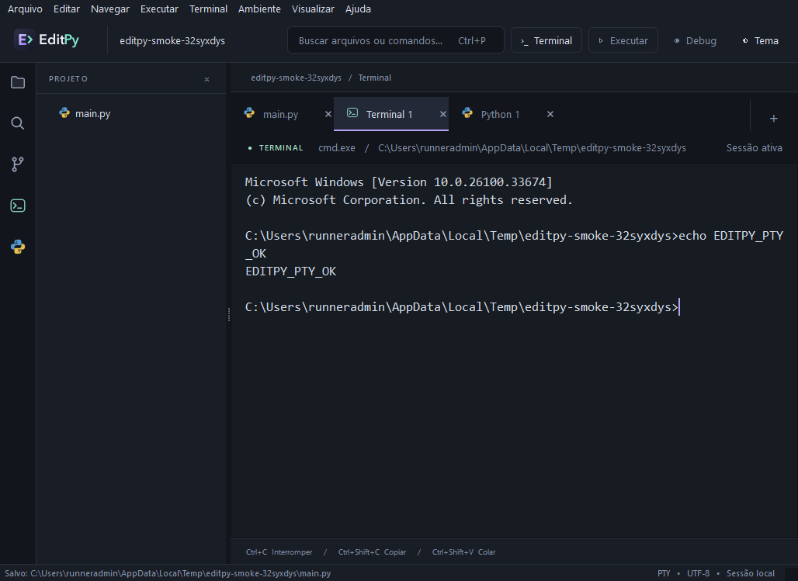

# EditPy para Windows

A versão Windows compartilha editor, projetos, temas, ícones, Jedi, Ruff, depuração pdb e console Python com o macOS. O terminal usa ConPTY por meio do pywinpty, com `cmd.exe` em cada aba e REPL Python em abas independentes.

## Requisitos e execução

- Windows 10 22H2 ou Windows 11, x64.
- Para editar e abrir o terminal: extraia todo o ZIP e execute `EditPy/EditPy.exe`.
- Para executar/depurar projetos e abrir o console Python: instale Python 3.11 ou superior e selecione `python.exe` em Arquivo → Preferências.
- Preserve o diretório `_internal` ao lado do executável. O pacote é portátil; não há instalador nesta versão.
- O executável ainda não possui assinatura Authenticode. Não representa uma distribuição comercial assinada.

A aparência usa fontes Windows e a barra de título acompanha o tema. Atalhos usam Ctrl; no terminal, Ctrl+C interrompe e Ctrl+Shift+C/V copiam/colam. Os argumentos de execução seguem o parsing nativo do Windows, incluindo espaços e aspas. Fechar o projeto encerra as sessões e trata documentos não salvos.

## Gerar em Windows

```powershell
py -3.14 -m venv .venv
.venv\Scripts\python.exe -m pip install -e ".[dev]"
.venv\Scripts\python.exe -m pytest -q
.venv\Scripts\python.exe scripts\build_windows.py
```

O build gera `dist/EditPy-0.4.0-Windows-x64.zip` e o SHA-256 correspondente. O ícone ICO contém sete resoluções. O empacotador inclui recursos, dependências nativas e avisos de terceiros, verifica o `.exe` e testa editor, execução, realce, terminal ConPTY, console e fechamento de projeto antes de criar o ZIP.

## Automação

O workflow `.github/workflows/windows.yml` executa testes e build em um runner Windows do GitHub Actions. O ZIP e o relatório de validação ficam no artefato `EditPy-Windows-x64` do run, com retenção de 30 dias.

Os testes específicos do Windows cobrem TTY real, entrada Unicode, sessão cmd, REPL, redimensionamento e argumentos/caminhos com espaços. Os testes POSIX permanecem separados. A validação automatizada não substitui revisão visual em computadores Windows físicos.

## Resultado de validação

A versão 0.4.0 foi gerada e validada no [runner Windows](https://github.com/eltpmoc/EditPy/actions/runs/43915587302): 33 testes passaram, com 8 cenários POSIX ignorados. O teste do executável empacotado retornou `ok: true`, incluindo fontes da interface nativa, terminal, console e fechamento de projeto. O ZIP portátil está na [release 0.4.0](https://github.com/eltpmoc/EditPy/releases/tag/v0.4.0).


